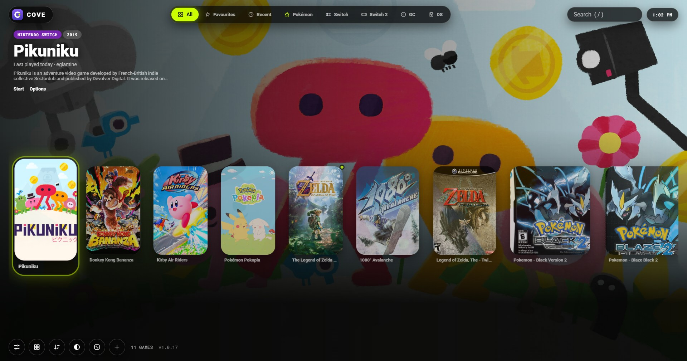
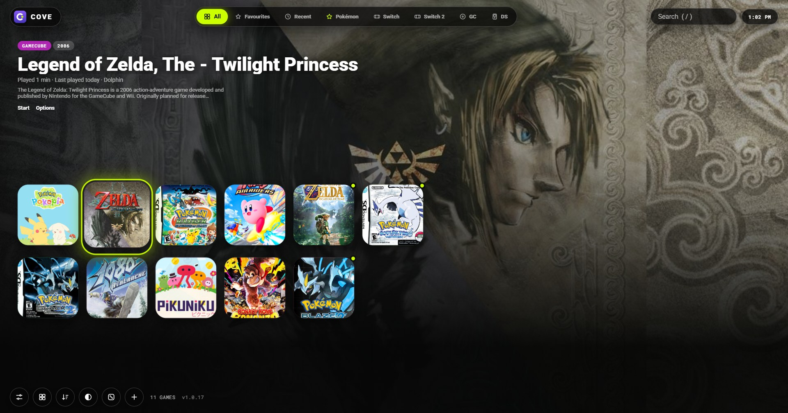
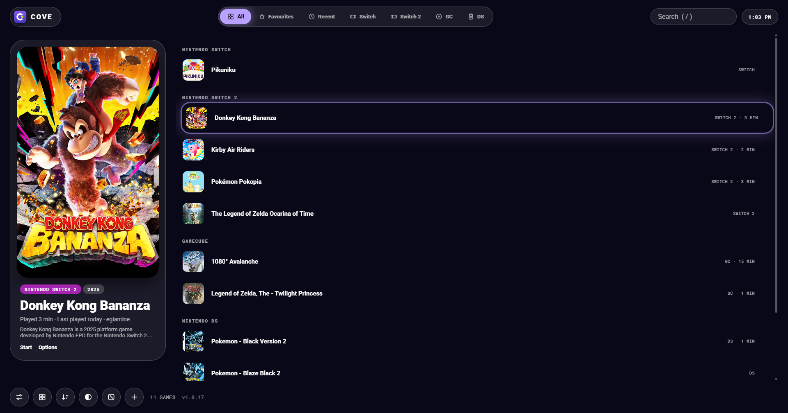
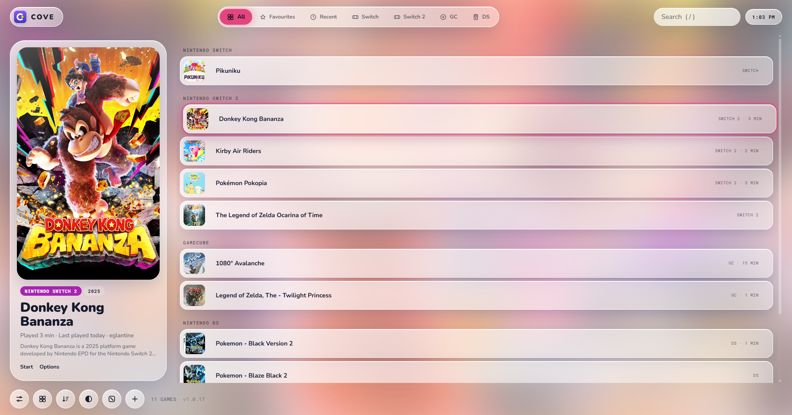
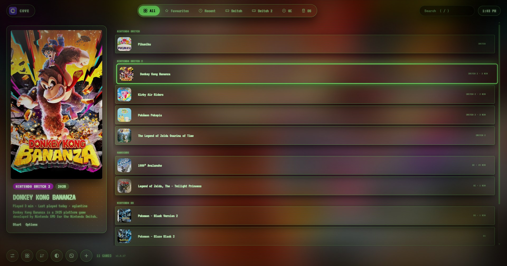

# Cove

One launcher for every emulator. Cove finds your emulators and your games, opens each game in the right emulator with the right settings, and looks like a console home screen.

## Screenshots

| | |
|---|---|
|  Full art style |  List layout, Aurora theme |
|  Light themes |  CRT retro theme |

## Download

**[Download Cove (zip)](https://github.com/calinado/cove/archive/refs/heads/main.zip)**

1. Unzip it anywhere, for example `C:\Games\Cove`.
2. Double-click `Cove.bat`.
3. Follow the three setup steps: where your emulators are, where your games are, done.

Windows 10 or 11. Nothing to install: Cove uses PowerShell and Microsoft Edge, which Windows already has. If Windows shows a blue "Windows protected your PC" box the first time, choose **More info**, then **Run anyway**.

Cove does not include any games, emulators, BIOS files or keys. You bring your own.

## Android (early, untested)

The `android` folder holds an early Android version for handhelds, with a second-screen card for dual-screen devices such as the AYN Thor. It shares `index.html` with the Windows version. It has not been built or tried on real hardware yet. To build it, open the `android` folder in Android Studio and run it, or run `gradle -p android assembleRelease`.

## What it does

- Recognises about 20 emulators, plus Switch and Switch 2 forks it has never seen, and lets you add any other `.exe`.
- Reads your games where they already are, in any folder layout, and works out the system for each one.
- Looks up a cover, a short description and the year for each game.
- Shows a preview card before a game starts: the game file, the emulator, and whether save data was found.
- Five layouts, fifteen themes, three styles, menu sounds, and full controller support.
- Covers shaped like each console's real game cases, and a launch screen that shows the game on its own disc or cartridge.
- Sorting, your own folders (drag one game onto another), and a Surprise me roll.
- Downloads RetroArch and the right core for older systems when you have no emulator for them.
- Imports saves and settings from one emulator into another of the same family, with a backup first.
- Optional Discord status showing what you are playing.

## Updates

Cove checks this repository each time it opens. When there is a newer version it shows what changed and asks before installing. Your games, settings and saves are never touched by an update.

## Controls

| Action | Keyboard | Controller |
| --- | --- | --- |
| Move | Arrow keys | D-pad or left stick |
| Start a game | Enter | A |
| Game options | O or right-click | Y |
| Favourite | F | X |
| Switch system | Q and E | LB and RB |
| Layout menu | L | Select |
| Settings | S | Start |
| Search | / | |

---

CALINADO © 2026
